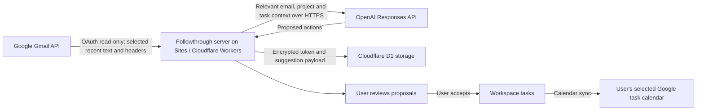

# Google security assessment handoff

Created by Cory McCabe. Prepared October 19, 2026. This is an evidence index and preparation checklist, not a certification, completed security assessment, or Letter of Assessment.

## Why an external assessment is expected

Followthrough requests gmail.readonly and processes selected email content on its server and through OpenAI. Plan for the restricted-scope security assessment unless Google confirms an applicable exception. Google requires periodic reassessment; Google, rather than the developer, determines the required assurance level. Do not assume an older “Tier 2” checklist or a self-assessment alone will satisfy the current requirement. [Google requirements](https://developers.google.com/identity/protocols/oauth2/production-readiness/restricted-scope-verification#security_assessment), [current CASA assurance levels](https://appdefensealliance.dev/casa/casa-tiering)

## Inputs needed from Cory

1. Any existing assessment, Letter of Assessment, Google verification/assessment email, case ID, assigned assurance level and deadline. Share identifiers/status first; sensitive reports belong in the assessor's approved channel.
2. Ethos's legal entity name and the person authorized to contract with an assessor. The support/contact address is hello@ethosapps.dev; the Cloud project parent still belongs to the original organization.
3. Select an assessor through the current authorized-lab process and approve its written quote, scope and timeline before a contract, payment, or testing authorization. No assessor has been hired and no cost has been incurred by this work. [Authorized labs](https://www.appdefensealliance.org/certification/authorized-labs)
4. Provide a designated test-account/workspace owner and an approved window for assessment testing. Any new assessor access must be explicitly scoped and approved at action time.
5. Confirm who manages the OpenAI API organization used for Gmail analysis and can provide its data-sharing/retention control evidence. Google data must not be opted into generalized model training. Source store:false is not proof of Zero Data Retention or the account's data-sharing setting.

## Data flow to give the assessor

The public actions/native relay forwards allowlisted service requests; Google OAuth callbacks terminate at the primary planner. Mac/iPhone clients use that web flow. Existing background Apps Script triggers call the service; include their access and secret handling in the assessment inventory. Forwarded email capture through Resend is a separate input path; include it when defining the full application boundary.

## Source-backed evidence and remaining checks

| Area | Current source evidence | Evidence still needed |
| --- | --- | --- |
| Minimum scopes | lib/google-calendar.ts declares four Calendar scopes; lib/gmail-client.ts declares gmail.readonly; no send/modify Gmail scope | Assessor review of every endpoint and continued need for legacy calendar.app.created; do not remove it without compatibility testing. |
| Bounded Gmail access | lib/gmail-client.ts and lib/gmail-suggestion-data.ts filter seven days, excluded categories, selected plain text; no attachment fetch | Controlled runtime trace and tests of excluded data, without collecting real mail into logs. |
| AI transfer | lib/gmail-analysis.ts passes email + project/open-task context through lib/capture.ts; Responses API uses store:false | OpenAI organization/project data-sharing and retention settings; provider agreements/subprocessor inventory and applicable region controls. |
| Secrets and owner isolation | lib/calendar-security.ts sealing; lib/suggestion-store.ts owner-scoped encrypted suggestion payload | Key management, authorized operators, rotation/revocation procedure, backup encryption/deletion, IAM and tenant-isolation assessment. Do not expose key values in evidence. |
| Retention and deletion | Pending suggestions unavailable after 30 days; cleanup on subsequent processing; content-free suppression expires after 90 days; Gmail-off clears pending state | Runtime test for disable/disconnect/export/erase; backup retention and operational deletion schedule. |
| Consent and review | In-app Gmail/OpenAI disclosure, explicit opt-in, proposals separate until acceptance | Clean demo video and reviewer access plan; successful live Gmail analysis on sample messages. |
| Web/native boundaries | Existing public relay allowlist and authentication tests pass; production audience unchanged | Independent authorization/session, OAuth state/PKCE, CSRF, replay, rate-limit, dependency, logging and infrastructure testing. Passing application tests is not a security certificate. |
| Administration | Ethos is an accepted project Owner and domain owner; original parent/owner retained | Business-account MFA, least-privilege IAM review, organization migration plan, incident contact and response procedure. |

The deployed public policy is https://actions.followthrough.site/privacy. Relay version 24, source c0716293defbbc1d24ff72ea9cce0fd69608b1e0, contains the new Gmail disclosures. All 24 relay tests passed; build and production deployment succeeded. Current Google branding including the mint bolt logo is verified and published. The Gmail use case and 662-character justification are saved, but the scopes are not approved and no Google data-access submission has been completed.

## Earliest honest completion state

Today we can finish the demo and submission packet once the test mailbox/workspace and YouTube destination are ready. The Google review and any mandated external assessment cannot be marked complete until those parties return approval. Keep Gmail's owner-pilot gate in place during preparation. No public rollout of unverified Gmail scopes is authorized by this packet.
